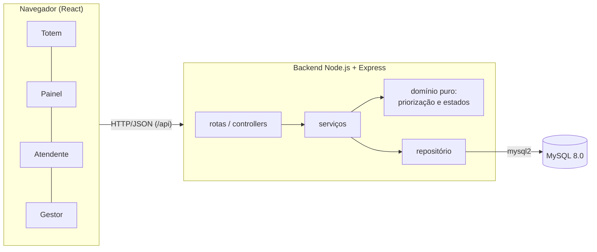

# nassauTickets

Sistema de Controle de Atendimento para um Laboratório de Análises Clínicas.

## Membros

| Nome | Matrícula | Papel |
|------|-----------|-------|
| Danielly Vieira Barbosa | 24005208 | Desenvolvedora |
| Elionaldo Damasceno Souza Sobrinho | 01524206 | Documentador |
| Wesllen Daniel Nunes da Silva | 01556000 | Documentador |
| Marcos Avelino Martins | 01050428 | Scrum Master |
| Eduardo Aleixo Melo Gama | 01560971 | Testador |
| Renata Cristina da Silva Sousa | 01559154 | Testadora |

## Sobre o projeto

O **nassauTickets** controla o atendimento de um Laboratório de Análises Clínicas por meio de **senhas**: o cliente retira a senha no **totem**, acompanha a chamada no **painel** (com áudio) e é atendido no **guichê**, onde o **atendente** chama, atende e finaliza. O **gestor** cadastra atendentes e guichês e consulta relatórios e auditoria.

É uma **aplicação Web** (sem aplicativo mobile).

### Objetivo

Organizar a fila de atendimento respeitando a priorização do laboratório, registrar cada etapa para auditoria e fornecer indicadores de desempenho. O projeto também é a atividade da disciplina: organizar, documentar, versionar e desenvolver um projeto Web com boas práticas.

### Funcionalidades

- **Totem** (`/totem`): emissão anônima de senha **SP** (prioritária), **SG** (geral) ou **SE** (retirada de exames), numerada como `YYMMDD-PPSQ` (ex.: `260325-SP001`).
- **Fila com priorização** `[SP] → [SE|SG] → [SP] → …`, atendida por qualquer guichê.
- **Atendente** (`/atendente`): chamar próxima, **chamar novamente** ("Última chamada"), iniciar, finalizar e registrar não comparecimento.
- **Painel** (`/painel`): 5 últimas chamadas com guichê, **áudio** da chamada e atualização automática.
- **Máquina de estados** da senha: `EMITIDA → AGUARDANDO → CHAMADA → CHAMADA_NOVAMENTE → EM_ATENDIMENTO → ATENDIDA` (ou `NÃO_COMPARECEU`).
- **Expediente** 07:00–17:00, com descarte das senhas que sobrarem.
- **Concorrência:** atendentes simultâneos nunca recebem a mesma senha.
- **Gestor** (`/gestor/*`): usuários, guichês, relatórios diário e mensal (emitidas/atendidas por prioridade, detalhado, **TM**, desempenho) e **auditoria**, com exportação CSV.
- **Resiliência:** se o backend ou o banco cair, o painel mantém a última lista com aviso, o totem orienta o cliente e as telas reconectam sozinhas.
- **LGPD e acessibilidade:** o cliente é anônimo (nenhum dado pessoal); interface pensada para WCAG 2.1 AA.

## Tecnologias

| Camada | Tecnologia |
|--------|-----------|
| Frontend | **React 19** + Vite, React Router, CSS próprio |
| Backend | **Node.js (LTS 22) + Express** (API REST/JSON) |
| Banco de dados | **MySQL 8.0** (via Docker Compose) |
| Segurança | JWT, bcrypt, helmet, CORS, rate limit, validação com zod |
| Testes | `node:test` + supertest (backend); Vitest + Testing Library (frontend) |
| Qualidade | oxlint (frontend) |
| Versionamento | Git / GitHub (`main` e `dev`) |

### Por que Node.js + Express no backend

A infraestrutura do laboratório admite Node.js 22/Express, Java 21/Spring Boot e Python 3.14/Flask ou FastAPI. Escolhemos **Node.js + Express** porque:

1. **Uma só linguagem (JavaScript)** no frontend (React) e no backend: o grupo reaproveita o que está estudando, compartilha convenções e o `.gitignore`/ferramental de Node exigido pela atividade.
2. **E/S assíncrona** combina com o perfil do sistema (muitas requisições curtas: totem, painel consultando a cada 2 s e atendentes).
3. **Menos infraestrutura** para desenvolver e rodar localmente (sem JDK/Maven nem nova versão de Python) e ciclo de feedback rápido.
4. **Maturidade** do ecossistema usado: `mysql2`, `express`, `jsonwebtoken`, `zod`.

Spring Boot seria uma boa opção para um time Java experiente, porém mais verboso para este escopo; FastAPI exigiria um segundo ecossistema (pip/venv) ao lado do npm.

## Arquitetura



Backend em camadas: `routes → controllers → services → repositories`, com o **domínio** (`prioridade.js`, `estados.js`) puro e testável. Toda operação que altera a fila roda numa **transação com trava** (`SELECT … FOR UPDATE` em `fila_estado`), o que resolve a concorrência. Mais diagramas em [`docs/models/uml/`](docs/models/uml/).

## Estrutura do projeto

```text
nassauTickets/
├── backend/
│   ├── db/                  schema.sql (MySQL 8.0)
│   ├── scripts/             seed.js, simulate.js (simulador de um dia)
│   ├── src/
│   │   ├── config/          variáveis de ambiente
│   │   ├── domain/          priorização e máquina de estados (puros)
│   │   ├── routes/ controllers/ middlewares/
│   │   ├── services/        regras de negócio
│   │   ├── repositories/    mysql e memory
│   │   └── jobs/            descarte no fim do expediente
│   ├── tests/
│   ├── docker-compose.yml   MySQL 8.0
│   └── .env.example
├── docs/
│   ├── branding/            identidade visual
│   ├── mer/                 modelo entidade-relacionamento e dicionário de dados
│   ├── mockups/             protótipos das telas (SVG)
│   ├── models/uml/          diagramas UML
│   └── requirements/        requisitos, regras, casos de uso, LGPD, testes...
├── frontend/
│   └── src/                 pages, components, hooks, services, context, utils, styles
├── .gitignore
├── LICENSE
└── README.md
```

## Como executar

### Pré-requisitos

- **Node.js 22 ou superior** e npm
- **Docker** (para o MySQL 8.0). Sem Docker, veja "Modo demonstração" abaixo.
- Git

### 1. Obter o código

```bash
git clone https://github.com/Daniellyv/nassauTickets.git
cd nassauTickets
git checkout dev
```

### 2. Banco de dados e backend

```bash
cd backend
cp .env.example .env          # Windows PowerShell: Copy-Item .env.example .env
docker compose up -d          # sobe o MySQL 8.0 e cria as tabelas (db/schema.sql)
npm install
npm run seed                  # cria o gestor, um atendente e 4 guichês
npm run dev                   # API em http://localhost:3000/api
```

Confira: `http://localhost:3000/api/health` deve responder `{"status":"ok","banco":"ok"}`.

### 3. Frontend

Em outro terminal:

```bash
cd frontend
npm install
npm run dev                   # http://localhost:5173
```

O Vite encaminha `/api` para `http://localhost:3000` (para outro endereço: `VITE_PROXY_TARGET=http://host:porta npm run dev`).

### 4. Usar o sistema

| Tela | Endereço | Acesso |
|------|----------|--------|
| Início | http://localhost:5173/ | livre |
| Totem | http://localhost:5173/totem | livre (cliente anônimo) |
| Painel | http://localhost:5173/painel | livre — clique em **Ativar áudio** |
| Atendente | http://localhost:5173/atendente | login |
| Gestor | http://localhost:5173/gestor/relatorios | login do gestor |

Usuários criados pelo `npm run seed` (valores de **desenvolvimento**, definidos em `backend/.env`; troque em qualquer outro ambiente):

| Perfil | Usuário | Senha |
|--------|---------|-------|
| Gestor | `gestor` | `Gestor@123` |
| Atendente | `atendente` | `Atendente@123` |

> O sistema só emite e chama senhas **das 07:00 às 17:00** (fuso `America/Recife`). Para testar fora do horário use `ENFORCE_EXPEDIENTE=false` no `.env`.

### Modo demonstração (sem Docker / sem MySQL)

```bash
cd backend
DB_DRIVER=memory ENFORCE_EXPEDIENTE=false npm run dev     # PowerShell: $env:DB_DRIVER='memory'; $env:ENFORCE_EXPEDIENTE='false'; npm run dev
```

Os dados ficam só na memória (somem ao reiniciar) e os usuários acima são criados automaticamente. Útil para demonstrar e para os testes automatizados, **mas o banco oficial do projeto é o MySQL**.

### Build do frontend

```bash
cd frontend && npm run build   # arquivos estáticos em frontend/dist
```

## Configuração (`backend/.env`)

| Variável | Padrão | Descrição |
|----------|--------|-----------|
| `PORT` | `3000` | Porta da API |
| `DB_DRIVER` | `mysql` | `mysql` ou `memory` |
| `DB_HOST` `DB_PORT` `DB_USER` `DB_PASSWORD` `DB_NAME` | `localhost` `3306` `nassau` `nassau_dev` `nassautickets` | Conexão com o MySQL (iguais às do `docker-compose.yml`) |
| `JWT_SECRET` | valor de desenvolvimento | **Obrigatório em produção** (`NODE_ENV=production`) |
| `JWT_EXPIRES_IN` | `8h` | Validade do login |
| `CORS_ORIGIN` | `http://localhost:5173` | Origens permitidas (separadas por vírgula) |
| `APP_TIMEZONE` | `America/Recife` | Fuso do laboratório |
| `EXPEDIENTE_INICIO` / `EXPEDIENTE_FIM` | `07:00` / `17:00` | Expediente |
| `ENFORCE_EXPEDIENTE` | `true` | `false` ignora o horário (testes) |
| `SEED_*` | ver `.env.example` | Usuários e guichês criados por `npm run seed` |

O arquivo `.env` **não é versionado**; use o `.env.example` como modelo.

## Testes e qualidade

```bash
cd backend  && npm test        # 83 testes (priorização, estados, concorrência, API, relatórios)
cd frontend && npm test        # 21 testes (totem, painel, falhas de rede, componentes)
cd frontend && npm run lint    # oxlint
```

### Simulador de atendimento

Simula um dia (07h–17h) com as estatísticas do enunciado (TM de SG 5±3 min, SP 15±5 min, SE 1 min/5 min; 5% de não comparecimento) usando os serviços reais:

```bash
cd backend
npm run simulate -- --guiches=3 --seed=7        # em memória
npm run simulate -- --driver=mysql --dias=10    # grava no banco para ver nos relatórios
```

Resultados e análise de dimensionamento em [`docs/requirements/desempenho-e-kpis.md`](docs/requirements/desempenho-e-kpis.md).

## API (resumo)

| Método e rota | Acesso | Descrição |
|---------------|--------|-----------|
| `GET /api/health` | público | Saúde da API e do banco |
| `POST /api/senhas` | público | Emite senha `{ "tipo": "SP\|SG\|SE" }` |
| `GET /api/painel` | público | 5 últimas chamadas |
| `POST /api/auth/login` | público | Login → token JWT |
| `POST /api/atendimento/chamar-proxima` | atendente | `{ "guicheId": 1 }` |
| `POST /api/atendimento/:id/{chamar-novamente,iniciar,finalizar,nao-compareceu}` | atendente | Ações sobre a senha |
| `GET /api/atendimento/{atual,filas}` | atendente | Atendimento em aberto / filas |
| `GET·POST·PUT /api/usuarios`, `POST·PUT /api/guiches` | gestor | Cadastros |
| `GET /api/relatorios/{diario,mensal,detalhado,auditoria}` | gestor | `?data=AAAA-MM-DD` ou `?mes=AAAA-MM` (`&formato=csv`) |

Rotas autenticadas usam `Authorization: Bearer <token>`.

## Branches e fluxo de trabalho

| Branch | Função |
|--------|--------|
| `main` | Versão estável/entregue. Recebe apenas **merges** da `dev` |
| `dev` | Desenvolvimento. Todo código é enviado primeiro aqui |

Fluxo: commits pequenos e objetivos na `dev` (`feat:`, `fix:`, `docs:`, `test:`, `chore:`) → ao concluir uma etapa, merge da `dev` na `main` (o histórico mostra o merge) → entrega da URL pública do repositório.

## Documentação

| Pasta | Conteúdo |
|-------|----------|
| [`docs/requirements/`](docs/requirements/) | [Requisitos funcionais](docs/requirements/requisitos-funcionais.md), [não funcionais](docs/requirements/requisitos-nao-funcionais.md), [regras de negócio](docs/requirements/regras-de-negocio.md), [casos de uso](docs/requirements/casos-de-uso.md), [LGPD e acessibilidade](docs/requirements/lgpd-e-acessibilidade.md), [recuperação de desastres](docs/requirements/recuperacao-de-desastres.md), [desempenho e KPIs](docs/requirements/desempenho-e-kpis.md), [plano de testes](docs/requirements/plano-de-testes.md), [rastreabilidade](docs/requirements/matriz-de-rastreabilidade.md) |
| [`docs/models/uml/`](docs/models/uml/) | [Casos de uso](docs/models/uml/casos-de-uso.md), [classes](docs/models/uml/classes.md), [máquina de estados](docs/models/uml/maquina-de-estados.md), [sequência](docs/models/uml/sequencias.md), [atividades](docs/models/uml/atividade.md), [implantação](docs/models/uml/implantacao.md) |
| [`docs/mer/`](docs/mer/) | [MER](docs/mer/mer.md) e [dicionário de dados](docs/mer/dicionario-de-dados.md) |
| [`docs/mockups/`](docs/mockups/) | Protótipos das telas (SVG) |
| [`docs/branding/`](docs/branding/) | [Identidade visual](docs/branding/branding.md) e logotipo |

## Limitações conhecidas

- A integração com **MySQL real** ainda precisa ser validada ponta a ponta (o ambiente de desenvolvimento não tinha Docker); o roteiro está em [`plano-de-testes.md`](docs/requirements/plano-de-testes.md#3-validação-com-mysql-obrigatória). Os testes automatizados rodam com o repositório em memória.
- Em produção é preciso colocar a API atrás de **HTTPS** e configurar **backup** do banco (não automatizados no projeto).
- Auditoria de acessibilidade com leitor de tela e testes de desempenho com carga **ainda não foram feitos**.
- O painel usa consulta periódica (2 s), não WebSocket; o áudio usa a Web Speech API (melhor em Chrome/Edge) e exige um clique para ser liberado.

## Licença

[MIT](LICENSE)
