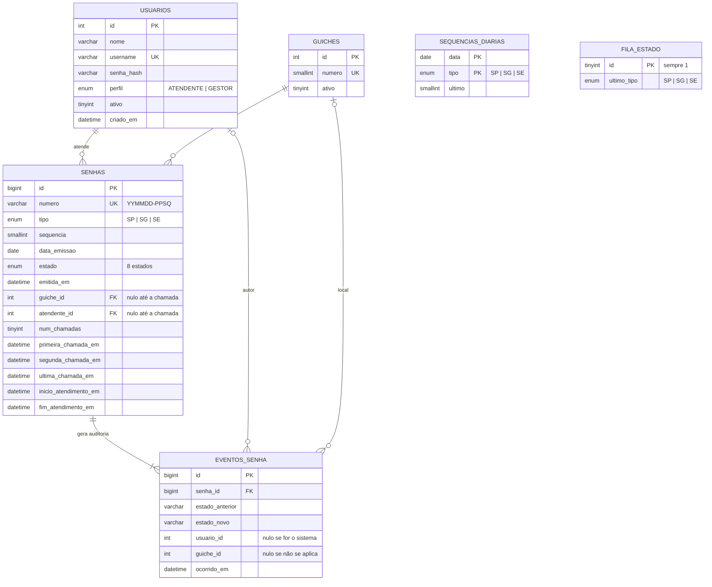

# Modelo Entidade-Relacionamento (MER)

Banco **MySQL 8.0**. Script de criação: [`backend/db/schema.sql`](../../backend/db/schema.sql). Descrição campo a campo em [dicionario-de-dados.md](dicionario-de-dados.md).

## Diagrama

`SEQUENCIAS_DIARIAS` e `FILA_ESTADO` são tabelas de **controle** (sem chave estrangeira): a primeira gera o `SQ` da numeração de forma atômica; a segunda guarda o tipo da última senha chamada e a **linha usada como trava** para serializar as operações da fila (concorrência).

## Cardinalidades

| Relação | Cardinalidade | Observação |
|---------|---------------|------------|
| Usuário → Senha | 1 : N (opcional) | Uma senha só tem atendente depois de chamada; um usuário atende muitas senhas |
| Guichê → Senha | 1 : N (opcional) | Idem |
| Senha → Evento | 1 : N (mín. 2) | Toda senha tem ao menos `EMITIDA` e `AGUARDANDO` |
| Usuário / Guichê → Evento | 0..1 : N | Eventos do sistema (emissão, descarte) não têm usuário |

## Decisões de modelagem

1. **Uma tabela `senhas` com os horários de cada etapa** (1ª e 2ª chamada, início, fim) em vez de tabelas separadas de chamadas/atendimentos. O enunciado limita a 2 chamadas e 1 atendimento por senha; assim os relatórios (detalhado, TM, auditoria) saem de uma consulta simples. O histórico completo de transições fica em `eventos_senha`.
2. **`eventos_senha` é somente inserção** (a aplicação nunca faz `UPDATE`/`DELETE`): trilha de auditoria.
3. **`data_emissao` separada de `emitida_em`:** o primeiro é a data **local** (America/Recife) usada na numeração e nos relatórios; o segundo é o instante exato em UTC. Evita erros de fuso na virada do dia.
4. **Restrições de integridade:** `numero` único; `(data_emissao, tipo, sequencia)` único (duas barreiras contra duplicidade); chaves estrangeiras de senha → guichê/usuário e evento → senha.
5. **Índices:** `(estado, tipo, emitida_em)` para achar a próxima senha da fila; `(data_emissao)` para relatórios; `(ultima_chamada_em)` para o painel; `(atendente_id, estado)` para o atendimento em aberto.
6. **Sem dados pessoais de cliente** no modelo (LGPD): nenhuma coluna de nome, documento ou contato.
7. **Estado como `ENUM`:** os 8 estados (7 do enunciado + `DESCARTADA`) estão fixos no banco; mudar a máquina de estados exige migração.
