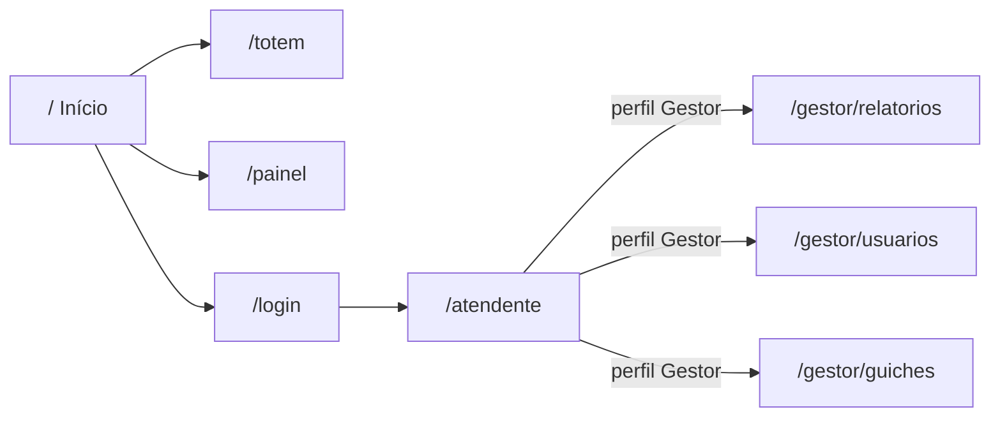

# Mockups

Protótipos de baixa/média fidelidade das telas, em **SVG** (abrem em qualquer navegador; no GitHub são exibidos na própria página do arquivo). Seguem a paleta e a tipografia de [docs/branding/branding.md](../branding/branding.md) e foram feitos **antes/em paralelo** à implementação; a aplicação real está em `frontend/src/pages/`.

| Tela | Rota | Mockup | Quem usa |
|------|------|--------|----------|
| Totem | `/totem` | [totem.svg](totem.svg) | Cliente (AC), anônimo |
| Painel de chamadas | `/painel` | [painel.svg](painel.svg) | Cliente, na TV da sala de espera |
| Login | `/login` | [login.svg](login.svg) | Atendente e gestor |
| Atendimento | `/atendente` | [atendente.svg](atendente.svg) | Atendente (e gestor) |
| Relatórios | `/gestor/relatorios` | [gestor-relatorios.svg](gestor-relatorios.svg) | Gestor |
| Usuários e guichês | `/gestor/usuarios`, `/gestor/guiches` | [gestor-cadastros.svg](gestor-cadastros.svg) | Gestor |

## Fluxo de navegação

## Decisões de design registradas

- **Totem:** três botões enormes, um por tipo de senha, com sigla + nome + descrição + cor. Nenhum campo de texto (LGPD e simplicidade).
- **Painel:** tema escuro de alto contraste para leitura à distância; a chamada atual ocupa a maior parte da tela; as quatro anteriores ficam em lista.
- **Atendente:** uma única ação principal por situação da senha (os botões mudam conforme o estado), para reduzir erros em atendimento corrido.
- **Gestor:** relatórios em abas (Resumo / Detalhado / Auditoria), com exportação CSV.
