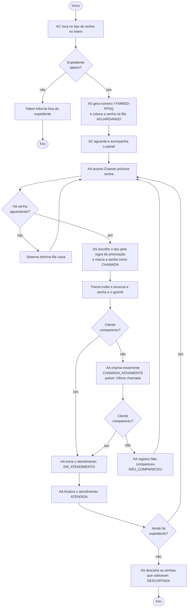
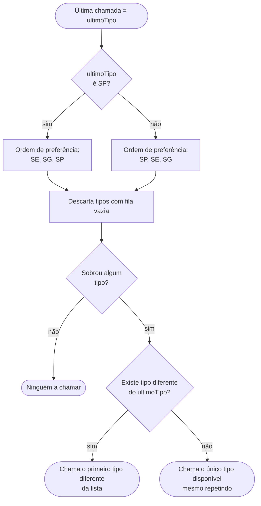

# Diagrama de atividades — ciclo de atendimento

## Fluxo completo (cliente + atendente + sistema)

## Decisão da próxima senha (`escolherProximoTipo`)

Exemplos: última = `SP`, filas `SE=1, SG=3, SP=2` → **SE**; última = `SE`, filas `SP=0, SE=4, SG=4` → **SG** (alterna); última = `SG`, filas `SP=0, SE=0, SG=9` → **SG** (única opção).
