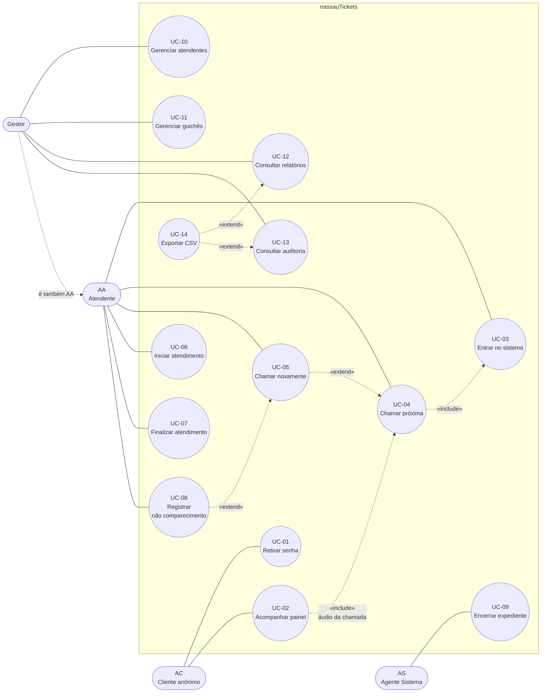

# Diagrama de casos de uso

Descrição textual de cada caso de uso em [docs/requirements/casos-de-uso.md](../../requirements/casos-de-uso.md).

O Mermaid não tem notação nativa de casos de uso; o diagrama usa atores (retângulos) e casos de uso (elipses) ligados por associações. O **Gestor** é um atendente com perfil adicional, portanto herda tudo o que o AA faz.

Observações:

- **UC-05** estende **UC-04**: só ocorre depois de uma chamada.
- **UC-08** só é possível depois do UC-05 (duas chamadas feitas).
- O painel (UC-02) mostra o resultado de UC-04 e UC-05; a relação é de *consumo* (o painel lê o estado), não de chamada direta.
