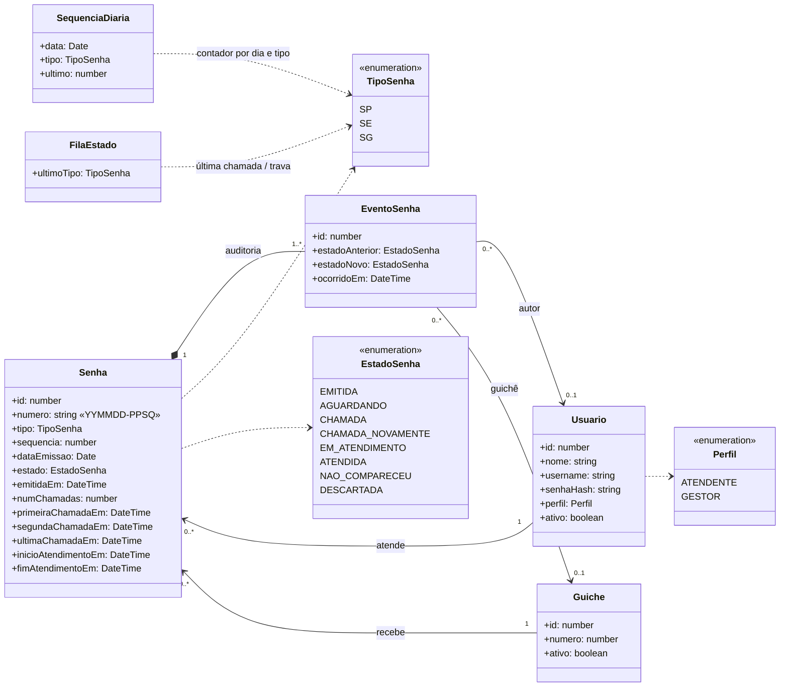
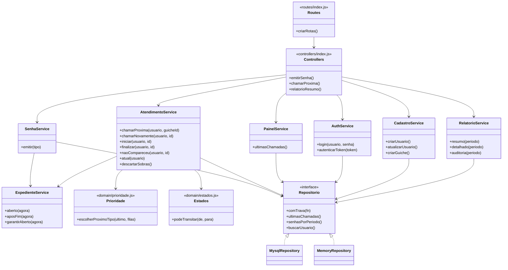

# Diagrama de classes

## Modelo de domínio

Entidades persistidas (espelham o [MER](../../mer/mer.md)) e os tipos de domínio.

## Camadas do backend

O **domínio** (`Prioridade`, `Estados`) é puro: sem I/O, testável isoladamente. Os repositórios têm a mesma interface, o que permite trocar `mysql` por `memory` (`DB_DRIVER`) sem alterar as regras.
