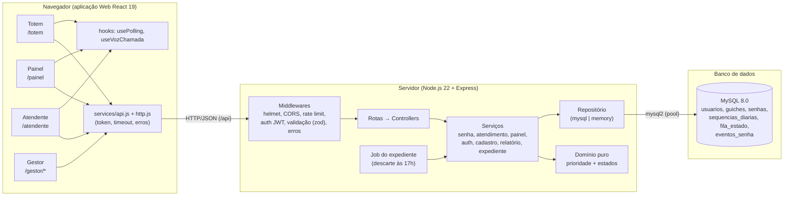
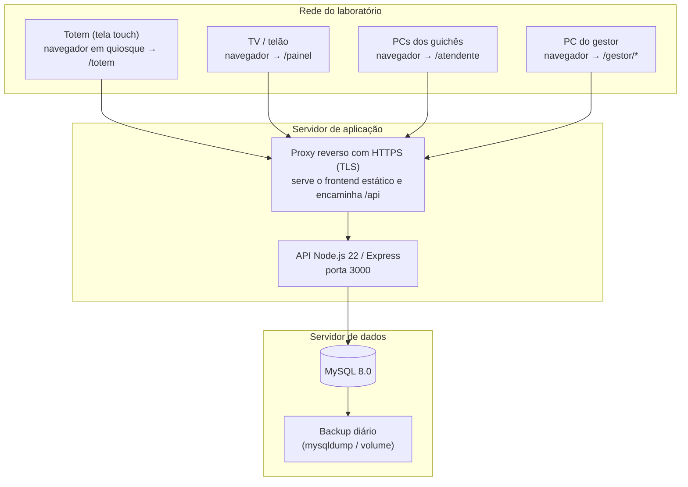

# Componentes e implantação

## Visão de componentes

## Implantação

| Elemento | Desenvolvimento | Produção (recomendação) |
|----------|-----------------|--------------------------|
| Frontend | `npm run dev` (Vite, porta 5173, proxy de `/api` para a 3000) | `npm run build` → arquivos estáticos em `frontend/dist` servidos pelo proxy reverso |
| Backend | `npm run dev` | `npm start` sob gerenciador de processos com *restart* automático; `NODE_ENV=production` e `JWT_SECRET` forte |
| Banco | `docker compose up -d` (em `backend/`) | MySQL 8.0 gerenciado ou dedicado, com backup e usuário de aplicação com privilégios mínimos |
| Segurança de transporte | HTTP local | **HTTPS obrigatório** no proxy reverso |

> A implantação em produção **não faz parte** das entregas do projeto; o diagrama descreve a arquitetura-alvo proposta.
