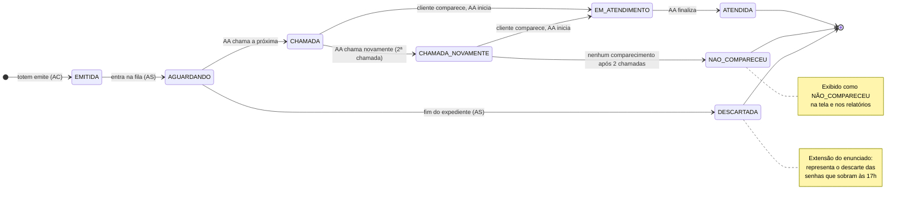

# Máquina de estados da senha

Implementada em [`backend/src/domain/estados.js`](../../../backend/src/domain/estados.js) e testada em `backend/tests/dominio.test.js`. Regra RN-080.

## Tabela de transições

| De | Para | Quem dispara | Efeito nos dados |
|----|------|--------------|------------------|
| — | EMITIDA | AC (totem) | cria a senha, número e horário de emissão |
| EMITIDA | AGUARDANDO | AS (imediato) | senha entra na fila do seu tipo |
| AGUARDANDO | CHAMADA | AA | grava guichê, atendente, `primeira_chamada_em`, `num_chamadas = 1` |
| CHAMADA | CHAMADA_NOVAMENTE | AA | `segunda_chamada_em`, `num_chamadas = 2` |
| CHAMADA / CHAMADA_NOVAMENTE | EM_ATENDIMENTO | AA | `inicio_atendimento_em` |
| CHAMADA_NOVAMENTE | NAO_COMPARECEU | AA | libera AA e guichê |
| EM_ATENDIMENTO | ATENDIDA | AA | `fim_atendimento_em`; libera AA e guichê |
| AGUARDANDO | DESCARTADA | AS (rotina das 17h) | — |

Toda transição grava uma linha em `eventos_senha` (auditoria). Qualquer outra tentativa é rejeitada com **HTTP 409** (`transicao_invalida`).
