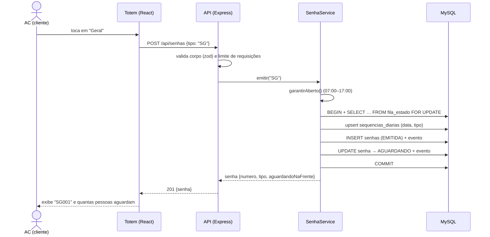
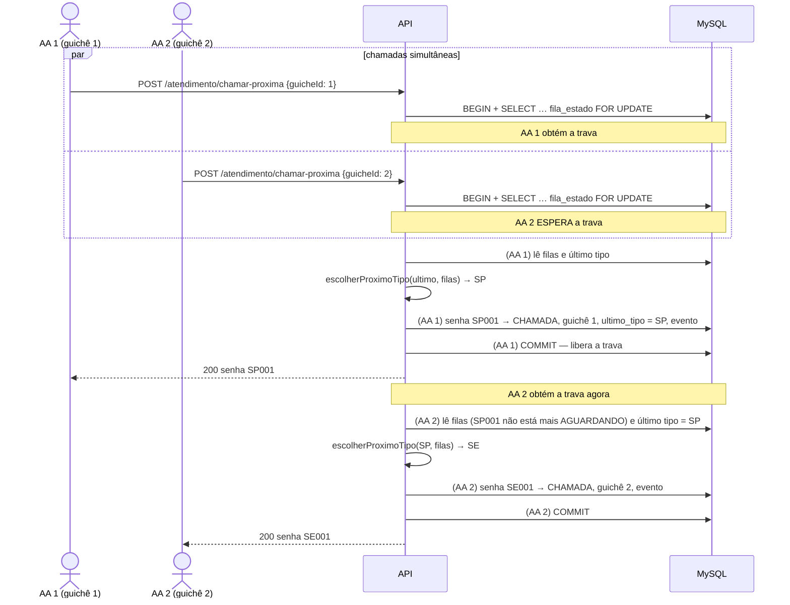
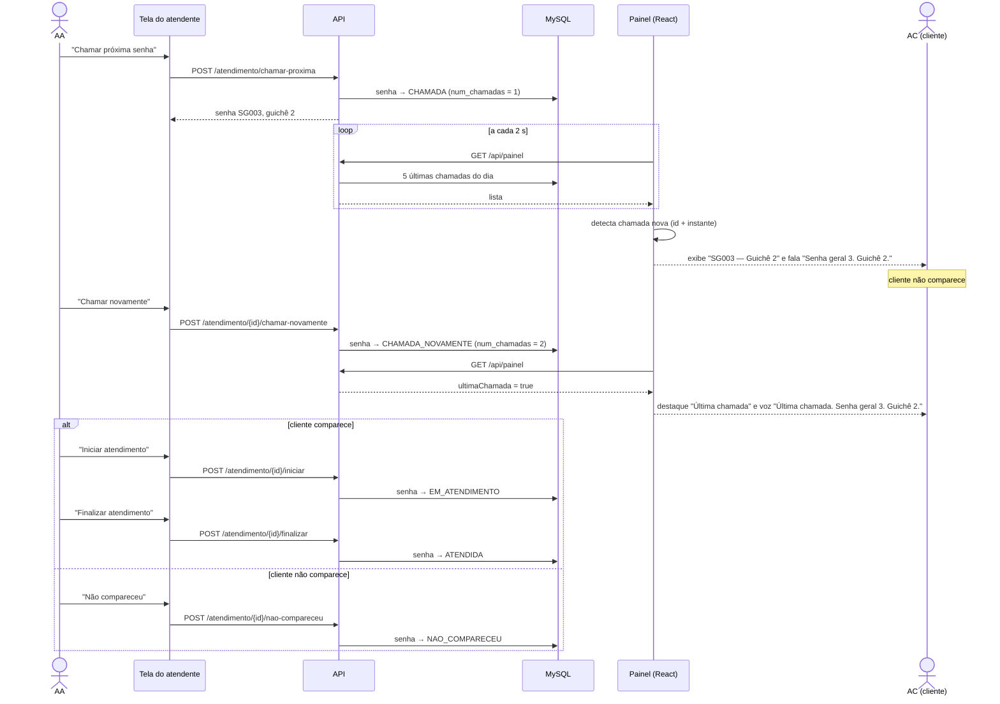
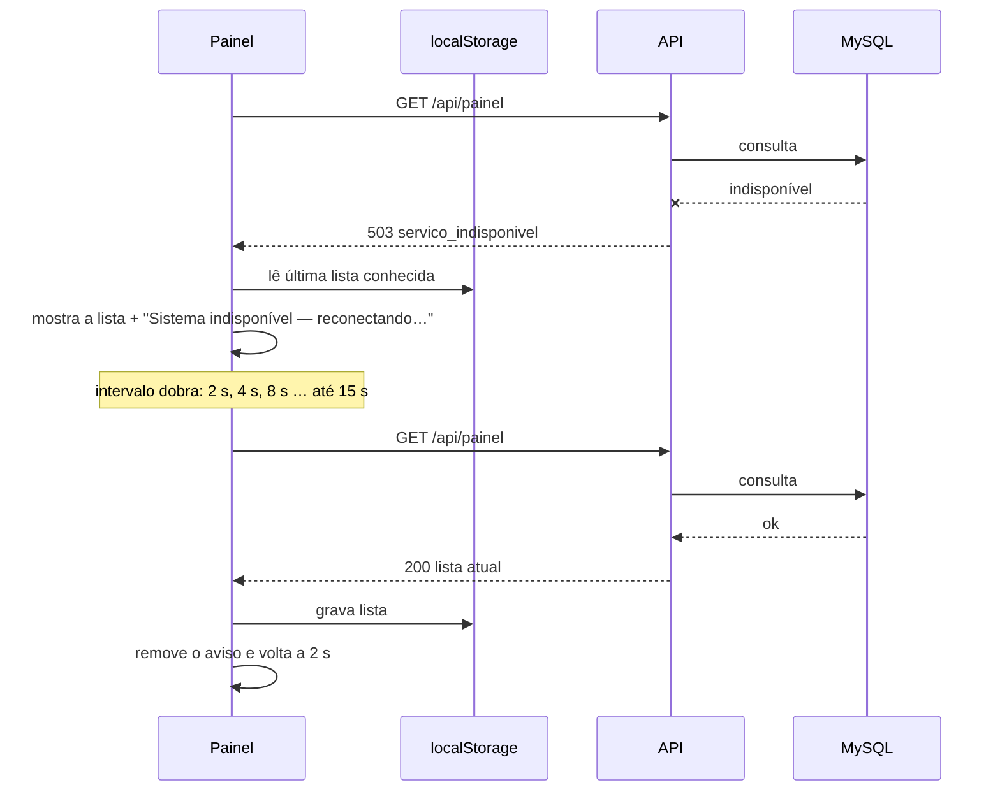

# Diagramas de sequência

## 1. Emitir senha (UC-01)

## 2. Chamar a próxima senha com concorrência (UC-04)

Dois atendentes pedem a próxima senha ao mesmo tempo. A trava na linha `fila_estado` serializa as operações: o segundo só lê o estado **depois** que o primeiro confirmou, então recebe outra senha.

Garantias: nenhuma senha é entregue duas vezes; o ciclo `[SP]→[SE|SG]→…` é respeitado mesmo sob disputa; o mesmo AA ou o mesmo guichê não conseguem abrir dois atendimentos (verificado dentro da transação).

## 3. Chamada, painel e áudio (UC-02, UC-04, UC-05)

## 4. Falha do banco (resiliência)

